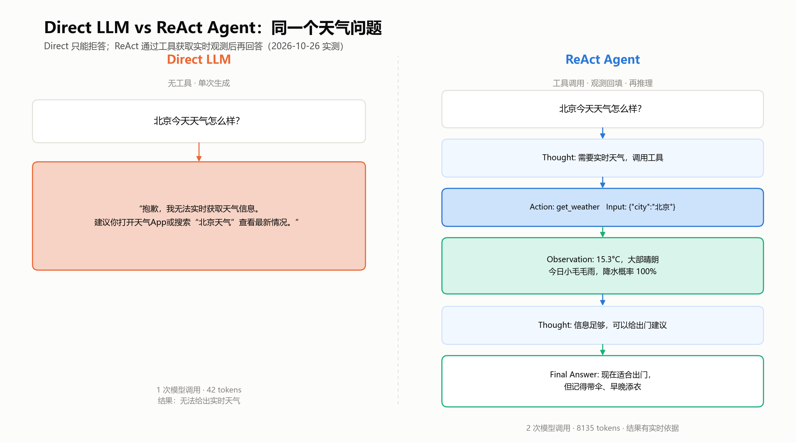

## Agent 基础实验报告：从 ReAct 论文到本地天气 Agent

**实验人：王旭帆**  
**日期：2026-10-26**  
**任务：Agent 基础——阅读 ReAct 论文，动手实现一个本地 Agent，能够调用 API/tool 完成任务（如天气查询）**

**摘要**：本实验阅读 ReAct 论文，手写了一个不依赖 LangChain 的本地 Agent。Agent 通过 `Thought → Action → Observation` 循环调用天气 API，在 2 次模型调用内完成北京天气查询；对照实验显示，纯 LLM 无法获取实时天气。进一步用天气、空气质量、文件写入三个工具完成了一个多工具任务。实验重点不是刷指标，而是把 ReAct 从论文公式拆成可运行、可观察、可验证的工程闭环。

**关键词**：ReAct；Agent；工具调用；DeepSeek；Open-Meteo

---

### 一、实验目的

1. 读懂 ReAct 论文的核心机制：Reasoning 与 Acting 如何交替。
2. 不依赖 LangChain / LlamaIndex，手写一个本地 Agent 的完整循环。
3. 接入真实外部 API（Open-Meteo 天气与空气质量），完成天气查询任务。
4. 通过实际运行验证：模型如何决定调用工具、工具结果如何回到上下文、Agent 如何给出最终答案。
5. 记录失败模式和工程约束，理解 Agent 与普通 LLM 问答的区别。

> 说明：这里的“本地 Agent”指 Agent 循环、工具执行和 Web 服务都在本机运行；模型本身通过 DeepSeek API 调用，不是本地权重推理。

---

### 二、ReAct 论文阅读

#### 2.1 核心思想

ReAct 的核心是让语言模型交替进行 **Reasoning（推理）** 和 **Acting（行动）**：

```text
Thought → Action → Observation → Thought → ... → Final Answer
```

- **Thought**：模型对当前任务、已有信息和下一步计划的推理。
- **Action**：模型选择一个外部动作，例如查天气、搜网页、读文件。
- **Observation**：环境执行动作后返回的结果。
- **Final Answer**：信息足够时给出最终回答。

论文：Yao et al., *ReAct: Synergizing Reasoning and Acting in Language Models*, arXiv:2210.03629, ICLR 2023。

关键点不是让模型“更聪明”，而是让模型的推理能够被外部工具的真实结果校正。模型仍然只负责生成文本；真正的工具执行、参数校验和结果回填由 Agent 代码完成。

#### 2.2 与 CoT / Act-only 的区别

| 方法 | 有推理 | 有外部动作 | 主要问题 |
|---|---|---|---|
| **CoT**（Chain-of-Thought） | 有 | 无 | 推理再长也拿不到实时信息，容易事实错误 |
| **Act-only** | 无 | 有 | 会调用工具，但缺少高层规划和错误修正 |
| **ReAct** | 有 | 有 | 推理指导动作，观察修正推理 |

天气查询是一个很典型的例子：模型内部知识无法回答“今天北京天气”，必须通过 Action 获取实时 Observation；只看 Observation 又无法判断“适不适合出门”，需要 Thought 把温度、降水、风力组合成建议。这正是 ReAct 想解决的两类问题。

#### 2.3 对实现的启示

读完论文后，我把实现拆成四个必须回答的问题：

1. **协议**：模型如何表达“我要调用哪个工具、参数是什么”？
2. **执行**：本地代码如何校验参数、执行工具、处理异常？
3. **回填**：工具结果如何变成模型能读懂的 Observation？
4. **收口**：模型格式错误、重复调用、无限循环时如何停止？

这四点在论文里是概念，在工程里必须落成代码。

---

### 三、系统设计

#### 3.1 总体架构


*图1：循环、工具、记忆与 Web 服务的总体关系。*

系统由五部分组成：

- **策略模型**：DeepSeek `deepseek-chat`，OpenAI 兼容 Chat Completions。
- **ReAct 循环**：`agent.py` 中的 `ReActAgent.run()`。
- **工具层**：`tools.py` 中的 `TOOL_SPECS`、`TOOL_FUNCS` 和 `run_tool()`。
- **外部 API**：Open-Meteo 天气、必应搜索；空气质量与汇率函数仍保留在内部库中，但未注册给模型。
- **交互层**：CLI 与本地 Web 聊天界面（FastAPI + SSE）。

当前动作空间共注册 15 个工具，本实验重点使用 `get_weather`、`web_search`、`fetch_url`、`write_file`；`apply_patch`、`run_tests`、`git` 与 `run_command` 用于本机文件修改、代码执行和自进化验证，写操作调用前需用户授权。

#### 3.2 ReAct 循环

核心循环可以压成下面这段伪代码：

```python
for step in range(1, MAX_STEPS + 1):
    scratchpad = compact_scratchpad(scratchpad)
    prompt = memory_context + history_text + question + scratchpad
    raw = llm.complete(
        system_prompt,
        prompt,
        stop=["Observation:", "Observation："],
    )

    kind, payload, thought = parse_output(raw)
    if kind == "final":
        return payload

    tool_name, raw_input = payload
    args = parse_action_input(raw_input, tool_name)
    observation = run_tool(tool_name, args, context=tool_context)
    scratchpad += format_step(thought, tool_name, args, observation)
```

三个关键设计：

1. **`stop=["Observation:", "Observation："]`**  
   强制模型在写完 Action 后停下，避免它自己编造工具结果。
2. **`parse_output()`**  
   识别 `Final Answer:`、`Action:` / `Action Input:`，兼容全角冒号、代码围栏和裸参数。
3. **`run_tool()`**  
   所有工具调用走统一出口：参数校验、类型转换、异常捕获、结果截断。

#### 3.3 工具接入

新增工具只需要三样东西：一个普通 Python 函数、一份 JSON Schema、一次注册。

```python
def get_weather(city: str) -> str:
    ...
    return "北京：大部晴朗，15.3°C，湿度 40%……"

TOOL_SPECS["get_weather"] = {
    "description": "查询指定城市的实时天气和未来 3 天预报。",
    "parameters": {
        "type": "object",
        "properties": {
            "city": {"type": "string", "description": "城市名称"}
        },
        "required": ["city"],
    },
}

TOOL_FUNCS["get_weather"] = get_weather
```

`describe_tools()` 会遍历 `TOOL_SPECS`，把工具名、说明和参数 schema 拼成纯文本，注入 system prompt。模型看到的不是 Python 函数，而是一份“工具菜单”。

模型输出 Action 后，统一走 `run_tool(name, args, context)`：

1. 查 `TOOL_SPECS`，未知工具返回可用工具列表；
2. 检查必填参数，忽略模型多给的参数；
3. 按 schema 做 `integer` / `number` / `string` / `boolean` 类型转换；
4. 需要上下文的工具注入 `ToolContext`；
5. 执行函数，捕获所有异常，统一转成 `ERROR: 工具 ... 执行失败：...`；
6. 结果截断到约 3000 字符。

工具函数的约定是：**只返回字符串，失败就抛异常，不打印、不控制循环**。这样任何工具错误都会变成一条模型能读懂的 Observation。


*图6：从函数、schema、注册到 `run_tool` 和 Observation 的完整链路。*

#### 3.4 天气工具

`get_weather(city)` 分两步：

1. **地理编码**：调用 Open-Meteo Geocoding API，把城市名转成经纬度。
2. **天气预报**：调用 Open-Meteo Forecast API，取当前天气和未来 3 天预报。

返回给模型的是一条格式化后的 Observation，而不是原始 JSON：

```text
地点：北京，北京市，中国
当地时间：2026-10-26 16:45（Asia/Shanghai）
当前天气：大部晴朗
气温：15.3°C（体感 12.6°C）
湿度：40% | 风速：6.0 km/h | 降水：0.0 mm
今日预报：2026-10-26 小毛毛雨，9.0~17.4°C，降水概率 100%
第 2 天预报：2026-10-27 晴，6.3~14.3°C，降水概率 0%
第 3 天预报：2026-10-28 阴，3.0~13.6°C，降水概率 0%
数据来源：Open-Meteo 公开 API
```

这一步很重要：**Observation 的格式也是 Agent 接口的一部分**。如果把原始 JSON 直接丢给模型，它会浪费 token 在解析结构上；整理成“地点 + 当前 + 预报 + 来源”的文本，模型更容易直接用于推理。

天气和空气质量都使用 Open-Meteo 公开 API，不需要额外 Key。

#### 3.5 解析与保护

模型不会永远守格式，所以循环里加了四类保护：

- **重复调用拦截**：完全相同的 `(工具名, 参数)` 只执行一次。
- **格式错误收口**：连续格式错误达到上限后提前结束，不再无限重试。
- **最大步数**：默认 8 步，超限时追加强制收口提示。
- **取消检查**：每次模型调用和工具调用前后检查取消信号。

这些约束不是“额外功能”，而是 ReAct 能稳定运行的前提。

---

### 四、实验与结果

#### 4.1 实验环境

| 项目 | 配置 |
|---|---|
| 操作系统 | Windows 11 |
| Python | 3.12.3 |
| 模型 | DeepSeek `deepseek-chat` |
| 温度 | 0.2 |
| 单次输出上限 | 2048 tokens |
| 天气 / 空气质量 | Open-Meteo 公开 API |
| 工具数量 | 21 |
| 离线测试 | 153 个用例 |

#### 4.2 工具自检

先运行不需要 API Key 的工具自检：

```bash
python agent.py --check-tools
```

结果：**15 个工具全部检查通过**。其中天气工具返回了北京的实时观测，说明外部 API 链路正常；`write_file`、`apply_patch`、`run_tests`、`git` 与 `run_command` 也完成了本地文件修改、测试和 Git 自检。

#### 4.3 对照实验：Direct LLM

为了说明“为什么需要 Agent”，先做一次不带工具的对照。直接向 DeepSeek 提问：

```text
北京今天天气怎么样？
```

模型回答：

> 抱歉，我无法实时获取天气信息。建议你打开天气App或搜索“北京天气”查看最新情况。

本次调用用量：**输入 18 + 输出 24 = 42 tokens，1 次模型调用**。

这个结果说明：纯生成模型没有实时数据源，无法完成天气查询任务。它这次选择了拒答，而不是编造天气；但无论拒答还是编造，都没有解决“获取实时信息”的问题。

#### 4.4 ReAct 天气任务

给 Agent 一个更完整的问题：

```text
北京今天天气怎么样？适合出门吗？
```

实际轨迹：

```text
--- 第 1 轮 ---
Thought: 用户问北京今天的天气和是否适合出门，需要调用天气工具获取实时数据。
Action: get_weather
Action Input: {"city": "北京"}
Observation: 地点：北京，北京市，中国
当地时间：2026-10-26 16:45（Asia/Shanghai）
当前天气：大部晴朗
气温：15.3°C（体感 12.6°C）
湿度：40% | 风速：6.0 km/h | 降水：0.0 mm
今日预报：2026-10-26 小毛毛雨，9.0~17.4°C，降水概率 100%
第 2 天预报：2026-10-27 晴，6.3~14.3°C，降水概率 0%
第 3 天预报：2026-10-28 阴，3.0~13.6°C，降水概率 0%
数据来源：Open-Meteo 公开 API

--- 第 2 轮 ---
Thought: 已拿到北京实时天气和今日预报，信息足够回答是否适合出门。
Final Answer: 北京今天（2026-10-26）的天气情况：

- **当前**（16:45）：大部晴朗，气温 15.3°C，体感约 12.6°C，湿度 40%，风速 6 km/h，暂无降水
- **今日预报**：小毛毛雨，气温 9.0~17.4°C，降水概率 100%

**出门建议**：现在这个时段天气还不错，晴朗、风小，适合出门活动；但今天整体降水概率是 100%，说明白天可能已经下过或稍后还会有零星毛毛雨，出门记得带把伞。傍晚气温会往 9°C 左右降，体感偏凉（现在体感只有 12.6°C），建议加件外套。

另外提醒：明天（10-27）转晴，6.3~14.3°C，降水概率 0%，是更适合户外活动的一天；后天（10-28）阴天，最低只有 3°C，会明显变冷。

数据来源：Open-Meteo 公开 API
```

本次调用用量：**输入 7846 + 输出 289 = 8135 tokens，2 次模型调用**。

对照结果：

- Direct LLM：1 次调用，42 tokens，只能拒答。
- ReAct Agent：2 次调用，8135 tokens，拿到实时天气并给出出门建议。



*图8：同一个天气问题下，Direct LLM 与 ReAct Agent 的差异（2026-10-26 实测）。*

#### 4.5 多工具任务

为了验证 Agent 不只是“单工具问答”，再做一个组合任务：

```text
查一下北京现在的天气和空气质量，整理成一份简短简报，保存到 demo/beijing_brief.md
```

> 说明：这一组实验在工具精简前完成，当时动作空间包含 `get_air_quality`；
> 当前版本已移除该工具，保留原始轨迹用于对照，不代表当前动作空间。

实际执行了 4 轮：

| 轮次 | Thought 概要 | Action | Observation 概要 |
|---|---|---|---|
| 1 | 先查天气 | `get_weather({"city": "北京"})` | 15.3°C，大部晴朗，今日降水概率 100% |
| 2 | 再查空气质量 | `get_air_quality({"city": "北京"})` | US AQI 168（不健康），PM2.5 22.6 μg/m³ |
| 3 | 整理并写文件 | `write_file({"path": "demo/beijing_brief.md", ...})` | 已写入 641 字符，文件共 1112 字节 |
| 4 | 信息足够 | `Final Answer` | 汇总天气、空气质量与提示 |

本次调用用量：**输入 16803 + 输出 788 = 17591 tokens，4 次模型调用**。

生成的文件位于 `workspace/demo/beijing_brief.md`（工具内相对路径 `demo/beijing_brief.md`），内容包括当前天气、未来三天预报、空气质量、出行提示和数据来源。

这个任务说明：ReAct 的工具可以组合。模型不需要预先知道“先天气、再空气质量、最后写文件”的固定流程，而是在每一轮根据已有 Observation 决定下一步。

#### 4.6 结果汇总

| 任务 | 方式 | 工具调用 | 模型调用 | tokens | 结果 |
|---|---|---|---|---|---|
| 北京今天天气 | Direct LLM | 0 | 1 | 42 | 无法实时获取 |
| 北京天气 + 出门建议 | ReAct Agent | `get_weather` | 2 | 8135 | 实时天气 + 建议 |
| 天气 + 空气质量 + 简报（工具精简前） | ReAct Agent | `get_weather`、`get_air_quality`、`write_file` | 4 | 17591 | 生成并保存简报 |

需要说明：ReAct 的 token 开销明显更高，因为它要携带系统提示词、工具 schema 和 scratchpad，并且每轮都要重新请求模型。这不是“效率更高”，而是“能完成 Direct LLM 完成不了的任务”。

#### 4.7 自动化测试

运行：

```bash
python -m unittest discover -s tests -v
```

结果：

```text
Ran 153 tests in 7.984s
OK (skipped=1)
```

153 个用例中 152 个通过，1 个符号链接用例因 Windows 权限跳过。覆盖 ReAct 解析与循环、工具安全、文件访问与命令执行、Git 与测试运行、自进化裁判与安全沙箱、SSRF 拦截、记忆并发与 TTL、上下文压缩、会话隔离、SSE、位置授权、工具授权、地理查询等。


*图2：153 个离线用例的分布。*

---

### 五、分析

#### 5.1 为什么 ReAct 有效

1. **Grounding（接地）**：天气是实时信息，模型内部知识不可靠；工具调用把答案锚定在真实观测上。
2. **Observability（可观察）**：Thought / Action / Observation 轨迹让每一步决策都可检查，便于调试和展示。
3. **Error recovery（错误恢复）**：工具异常会变成 Observation，模型可以根据错误信息换参数或换工具。
4. **Composability（可组合）**：新增工具不需要改循环；模型可以在多轮中组合天气、空气质量、文件写入等能力。

#### 5.2 失败模式与工程约束

| 风险 | 表现 | 本项目对策 |
|---|---|---|
| 模型不按格式输出 | 没有 Action，或参数不是 JSON | 解析器容错 + 格式纠错 Observation + 连续错误收口 |
| 模型编造 Observation | 自己写“Observation: 晴” | `stop` 序列强制在 Action 后停下 |
| 重复调用 | 反复调用同一个工具 | `(工具名, 参数)` 去重 |
| 无限循环 | 一直不给出 Final Answer | `MAX_STEPS=8`，超限强制收口 |
| 工具异常 | 网络错误、参数错误 | `run_tool` 捕获异常，转成 ERROR Observation |
| 高危本机操作 | 误写文件、执行破坏性命令 | 写/编辑/命令调用前由用户一次性授权；提示词限制高危命令；命令超时终止进程树 |
| 工具选错 | 该查天气却查汇率 | 工具描述 + schema；仍需在评测中继续优化 |
| 成本过高 | 多轮调用、token 增长 | 上下文压缩、Observation 截断、最大步数 |

#### 5.3 局限

- 这是一个**机制复现**，不是 ReAct 论文的指标复现；没有公开 benchmark、baseline 和统计检验。
- 当前有 15 个工具，仍多于论文通常的受控动作空间；工具数量本身会增加工具选择难度，不能把实验结果直接归因于“ReAct 更强”。
- 默认允许文件工具访问本机任意路径，`run_command` 以当前用户权限执行命令；现有防护是用户确认和提示词约束，不是权限沙箱。
- 模型仍然是云端 DeepSeek API，不是本地权重；“本地”指 Agent 循环、工具和 Web 服务在本机。
- 使用文本协议而不是原生 function calling；没有并行工具调用。
- 记忆系统、上下文压缩等能力已经实现，但本实验没有做消融，不能单独量化它们的贡献。
- 天气、空气质量依赖外部公共 API，受网络、限流和服务可用性影响。

---

### 六、结论与心得

本实验完成了任务要求：阅读 ReAct 论文，手写一个本地 Agent，接入真实天气 API，并完成天气查询和多工具任务。

最重要的结论是：

> **ReAct 不是一个模型能力，而是一套工程循环。模型只负责“决定下一步”，真正的能力来自工具、观测和约束。**

具体收获：

1. **Prompt 格式就是协议**。`Thought / Action / Action Input / Final Answer` 不是装饰，而是模型和代码之间的接口。
2. **Observation 是接口设计**。工具返回什么格式，直接决定模型能不能用得好。
3. **错误处理是核心功能**。工具报错、格式错误、重复调用、步数超限，都必须变成模型能理解的反馈。
4. **Agent = 模型 + 工具 + 循环 + 约束**。缺任何一块，系统都不稳定。

后续可以沿着三个方向继续：

- 把动作空间收敛到 `search / fetch / finish`，和论文的最小设定对齐；
- 做任务级评测，对比 Direct / CoT / Act-only / ReAct；
- 比较文本协议与原生 function calling，并做记忆消融。

---

### 七、复现方式

```bash
cd E:\react_agent
pip install -r requirements.txt
copy .env.example .env
# 编辑 .env，填入 DEEPSEEK_API_KEY
```

工具自检：

```bash
python agent.py --check-tools
```

运行天气任务：

```bash
python agent.py "北京今天天气怎么样？适合出门吗？"
```

启动 Web 界面：

```bash
python server.py
```

运行测试：

```bash
python -m unittest discover -s tests -v
```

> 注意：天气和空气质量是实时数据，重新运行得到的数值会不同；本报告记录的是 2026-10-26 的实际输出。

---

### 附录 A：代码结构

| 文件 | 作用 |
|---|---|
| `agent.py` | ReAct 循环、解析、上下文压缩、CLI |
| `tools.py` | 15 个注册工具 + `TOOL_SPECS` / `TOOL_FUNCS` / `run_tool` |
| `prompts.py` | ReAct 系统提示词、记忆与工具安全规则 |
| `llm.py` | DeepSeek Chat Completions 客户端 |
| `server.py` | FastAPI 服务、SSE、会话 API |
| `memory.py` | 会话/全局记忆、TTL、检索与注入 |
| `vector_memory.py` | 本地特征哈希向量索引 |
| `storage.py` | 共享路径锁 + JSON 原子写入 |
| `sessions.py` | 会话持久化 |
| `tests/` | 153 个离线测试 |

### 附录 B：完整天气任务轨迹

```text
问题：北京今天天气怎么样？适合出门吗？

--- 第 1 轮 ---
Thought: 用户问北京今天的天气和是否适合出门，需要调用天气工具获取实时数据。
Action: get_weather
Action Input: {"city": "北京"}
Observation: 地点：北京，北京市，中国
当地时间：2026-10-26 16:45（Asia/Shanghai）
当前天气：大部晴朗
气温：15.3°C（体感 12.6°C）
湿度：40% | 风速：6.0 km/h | 降水：0.0 mm
今日预报：2026-10-26 小毛毛雨，9.0~17.4°C，降水概率 100%
第 2 天预报：2026-10-27 晴，6.3~14.3°C，降水概率 0%
第 3 天预报：2026-10-28 阴，3.0~13.6°C，降水概率 0%
数据来源：Open-Meteo 公开 API

--- 第 2 轮 ---
Thought: 已拿到北京实时天气和今日预报，信息足够回答是否适合出门。
Final Answer: 北京今天（2026-10-26）的天气情况：

- **当前**（16:45）：大部晴朗，气温 15.3°C，体感约 12.6°C，湿度 40%，风速 6 km/h，暂无降水
- **今日预报**：小毛毛雨，气温 9.0~17.4°C，降水概率 100%

**出门建议**：现在这个时段天气还不错，晴朗、风小，适合出门活动；但今天整体降水概率是 100%，说明白天可能已经下过或稍后还会有零星毛毛雨，出门记得带把伞。傍晚气温会往 9°C 左右降，体感偏凉（现在体感只有 12.6°C），建议加件外套。

另外提醒：明天（10-27）转晴，6.3~14.3°C，降水概率 0%，是更适合户外活动的一天；后天（10-28）阴天，最低只有 3°C，会明显变冷。

数据来源：Open-Meteo 公开 API
```
